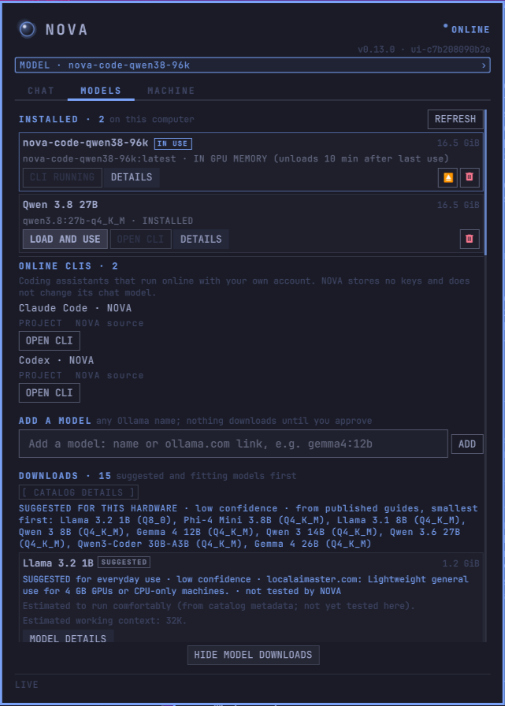
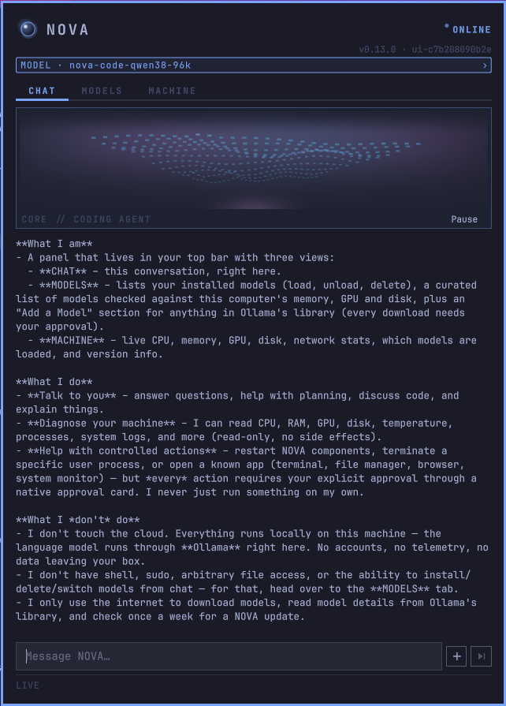
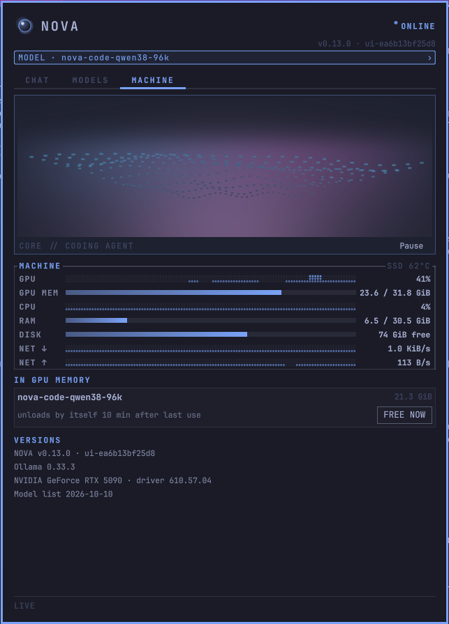
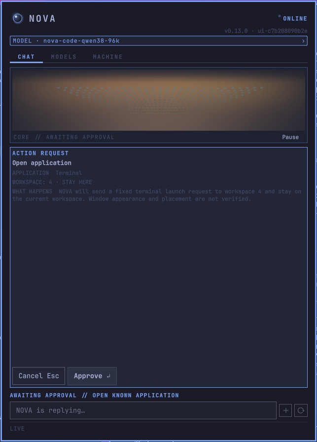

# NOVA

**All your local AI models in one place: picked for your hardware, installed and kept up to date, private and secure, without the terminal.**

NOVA is a plugin for [Omarchy](https://omarchy.org) that manages the AI models running
on your own computer. It looks at your hardware and shows which models will actually
run well on it, installs the one you pick, tells you when Ollama publishes a newer
build of a model you have, and gives you a private chat in your top bar to use them.

It's made for people who are **new to Omarchy or Linux** and don't want to learn
`ollama pull`, VRAM math and systemd before trying a local model. If you know all that
already, NOVA still saves you the guesswork and the upkeep.



## What it does for you

- **Picks models that fit your PC.** NOVA reads your graphics card, memory and disk,
  and marks every model in its list as a comfortable fit, a tight fit, or too big,
  *before* you download anything. Suggestions come from published guides and say so.
- **Installs them for you.** Click **INSTALL**, read the approval card (size, disk
  space left afterwards, fit), click **Approve**. NOVA downloads the model and checks
  that the file is exactly the version it checked. No commands to type.
- **Keeps them up to date.** Once a week NOVA checks Ollama's library for newer builds
  of the models you have and says what changed in plain words ("chat template and
  settings, about 12 KB" or "new model weights, 1.3 GB"). Nothing downloads until you
  click **UPDATE** and approve; skip a version if you'd rather keep yours.
- **One place to manage them.** Load, unload, update or delete models, see which one
  is in memory, and add any model from Ollama's library, each checked against your
  hardware first.
- **Gives you a chat in the top bar.** Answers stream in; NOVA knows it's on Omarchy
  and can look up live information about your machine when you ask.
- **A coding assistant on your own model.** Omarchy installs OpenCode; **SET UP CODING
  CLI** on a model's card connects it in one approval (a build of that model with the
  right working context, made from the files you have: no download). It asks before it
  edits files or runs commands. **TUNE** shows how much working context fits your graphics
  card and warns before a setting that would make it slow; the assistant can also ask NOVA
  for more context itself, and you decide.
- **Claude Code and Codex too.** Omarchy installs both; **ONLINE CLIS → SET UP** adds
  OPEN CLI for either in one approval. They sign in with your own account; NOVA keeps no keys.
- **Shows what your machine is doing.** CPU, graphics, memory, disk, network, and which
  model is currently loaded, with one click to free its memory.
- **Never does anything behind your back.** Every download, deletion, restart or app
  launch waits for your **Approve** on a card that says exactly what will happen.
- **Secure by design.** NOVA's helpers answer only your own user account, nothing runs
  as root, and every download is checked against the exact build you approved.
  [Details below](#privacy-and-security).

<p>
  
  
  
</p>

## Install (about 5 minutes, plus the model download)

You need Omarchy and an internet connection. A graphics card helps but isn't
required: NOVA suggests smaller models for computers without one.

1. Press **Super + Space** to open the Omarchy menu, then go to **Setup → Plugins →
   Add Plugin**, and paste this address:
   ```
   https://github.com/Yangass/omarchy-nova
   ```
   Omarchy then warns that plugins run code on your computer. It shows this for every
   plugin; [docs/HOW_IT_WORKS.md](docs/HOW_IT_WORKS.md) explains what NOVA runs.
   Answer **Yes** to enable it and keep the suggested position in the bar.
2. Click the new NOVA icon in the top bar. NOVA shows one step at a time:
   1. **SET UP NOVA** installs its small background helpers (no password needed).
   2. **INSTALL OLLAMA** installs the free engine that runs the models, if you don't
      have it yet. A terminal opens and asks for your password once; that's all the
      terminal you'll need.
   3. Open **MODELS** and click **BROWSE MODEL DOWNLOADS** at the bottom. Pick a model
      marked as a good fit, click its **INSTALL** button and approve.
3. When the download finishes, click **LOAD AND USE** and start chatting in **CHAT**.

Models take 1–25 GB of disk space each; NOVA tells you the size before you start.

## Update

**NOVA itself:** NOVA checks once a week for a newer version and shows **UPDATE NOVA**
in the panel. Click it and press Enter in the window that opens.

**Your models:** a model with a newer build gets an **UPDATE** tag in **MODELS** (and a
dot on the tab). Click **UPDATE**, read the approval card, click **Approve**. **REFRESH**
checks right away instead of waiting for the weekly check.

## Remove

**MACHINE → REMOVE NOVA…** (or right-click NOVA's icon in the bar → **Remove NOVA…**). Choose
what goes, with the space each choice frees:

- **Everything**: NOVA, its settings and chats, every model, and Ollama itself;
- **NOVA and its models**: Ollama stays for other tools;
- **NOVA only**: Ollama and every model stay.

Every model that goes is listed first, and one NOVA didn't install is marked. After "are you
sure?", a terminal opens and shows each step. It asks for your password once, and only to
remove Ollama.

Without the panel, open a terminal (**Super + Enter**) and paste:

```bash
bash ~/.config/omarchy/plugins/io.github.yangass.nova/tools/nova-uninstall.sh
```

That removes NOVA only (it asks first); add `--models` or `--everything` for more, or
`--dry-run` to see the steps without doing them.

## Privacy and security

Your chats and files stay on your computer. NOVA uses the internet only to:

- read model details from Ollama's library and download the models you approve;
- check once a week for newer builds of your models, and for a newer NOVA.

Claude Code and Codex, if you set them up, are online services: what you type in them goes
to Anthropic or OpenAI under your own account. NOVA only opens them.

No account, no telemetry. And on your computer:

- **Only you.** NOVA's helpers use no network ports. They listen only in your private
  runtime folder, which no other account on the PC can open, and on every connection
  they ask the Linux kernel who is on the other side. Nobody else can reach them or
  answer in their place, and a web page open in your browser can't reach them at all.
- **No root.** NOVA runs as you. The only password prompt is the one-time Ollama install.
- **You approve every change.** The chat model can suggest an action; only your click on
  **Approve** runs it, once, before the approval expires.
- **Exact downloads.** Every model is checked against the exact build shown on its
  approval card; anything else is reported as a failure.
- **Safe answers.** Chat formatting is applied after the model's text is escaped, so an
  answer can't load images, open links or inject anything into the panel.

## Good to know

- **Requirements:** Omarchy (Arch Linux + Hyprland). Python and everything else NOVA
  needs come with Omarchy; Ollama 0.6.5 or newer is installed for you if missing.
- **Graphics cards:** NVIDIA, AMD and Intel are recognised. Without a dedicated card
  models run on the processor: slower, but small models work fine.
- **More models:** anything from [Ollama's library](https://ollama.com/library) can be
  added under **ADD A MODEL**; NOVA checks it the same way before you install.
- **Coding CLI:** **SET UP CODING CLI** on a model's card connects OpenCode in one
  approval. Your own OpenCode settings stay as they are: NOVA hands over its settings only
  when it opens OpenCode. Claude Code and Codex are set up under **ONLINE CLIS**; others can
  be added in `~/.config/nova/cli-profiles.json`.
- **How it works inside:** [docs/HOW_IT_WORKS.md](docs/HOW_IT_WORKS.md). Security
  details and how to report a problem: [SECURITY.md](SECURITY.md).

## Who makes it

NOVA is built by one person, [Konstantin Tarasevic](https://github.com/Yangass), with AI
doing much of the engineering: Claude as lead developer and reviewer, and a local Qwen
model (running through NOVA) for small, well-defined tasks. Every change is covered by
automated tests, and releases are tried on a fresh Omarchy machine before they ship.

Found a problem or have an idea? [Open an issue](https://github.com/Yangass/omarchy-nova/issues).

## License

[MIT](LICENSE)
